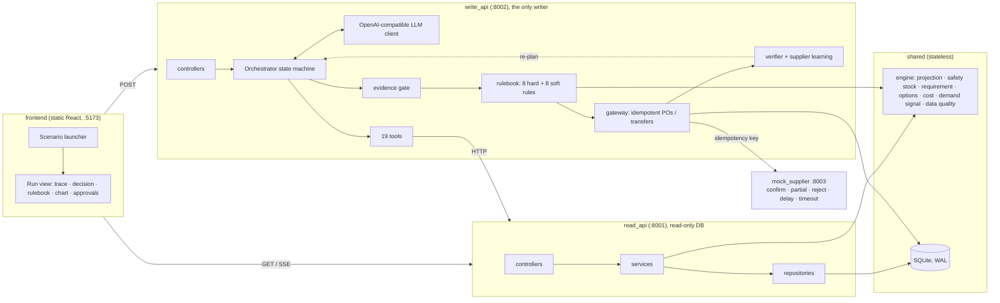
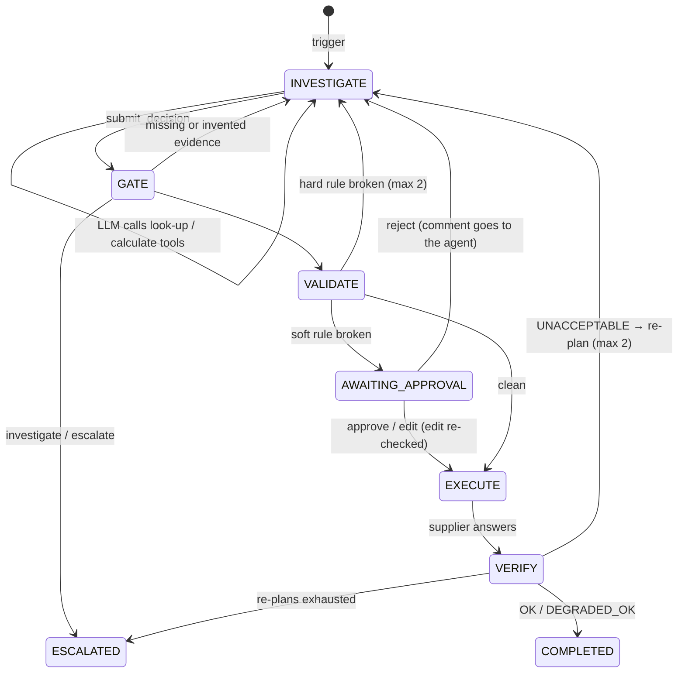

# AI Purchasing Agent

An agent for a quick-commerce business (dark stores) that takes a purchasing situation, **investigates**
the facts, **decides**, **acts** (places purchase orders or moves stock), and **verifies its own action**
against what the supplier actually did. It is not a chatbot that answers purchasing questions.

| Scenario | Trigger | What the agent works out |
|---|---|---|
| **S1** Review a recommendation | the replenishment system proposes a PO | accept / modify / reject / investigate: open POs it ignored, MOQ vs shelf life, phantom stock |
| **S2** Supplier can't fulfil | a supplier confirms only part of a PO | does it matter? transfer from another dark store, second supplier, or escalate |
| **S3** Demand changed | sales diverge from the forecast | real level change vs promotion vs one-off spike; plan on evidenced demand |
| **S4** Constraints | any of the above | storage on delivery day, budget, shelf life, express bridge, human approval, re-plan after a partial delivery |

---

## Quick start
Requirements: Python 3.12+, Node 20+.
```bash
make setup     # venv + npm install; creates backend/.env and backend/llm.env from the examples
make dev       # read_api :8001 · write_api :8002 · mock_supplier :8003 · UI http://localhost:5173
make test      # 114 tests, no API key needed
make smoke     # real processes, one scenario end to end
make eval      # scenario evaluation → backend/evals/reports/
```
In the UI, pick a scenario and click **Run · baseline** (no key needed) or **Run · LLM**.
After pulling schema changes, run `make clean` once.

### LLM configuration: `backend/llm.env`
Only three generic fields; any OpenAI-compatible endpoint works with **no code change**:
```env
LLM_BASE_URL=https://generativelanguage.googleapis.com/v1beta/openai/
LLM_API_KEY=...
LLM_MODEL=gemini-3.5-flash-lite
```
Optional: `LLM_MODE=baseline` (no LLM at all), `LLM_MIN_INTERVAL_S` / `LLM_RATE_LIMIT_WAITS` (free-tier
pacing). Tested free presets are in `backend/llm-examples/`. Check an env file with
`make llm-check ENV=llm-examples/gemini.env` (sends a tool-call test).

---

## Architecture



**Read/write split.** `read_api` opens SQLite with `mode=ro`, so investigation physically cannot change
data (a test proves it). `write_api` is the only service that writes, and every write goes through
validation → approval → idempotent execution → verification. The agent investigates *only* through the
Read API and acts *only* by submitting a decision; **no tool lets the LLM place an order**.
`tests/architecture/test_imports.py` enforces the boundaries (`read_api` and `write_api` never import
each other; the engine does no I/O).

```
backend/
  shared/        stateless: config, DB schema, domain types, engine (pure maths), snapshot, logging
  read_api/      server/ controllers/ services/ repositories/ schemas/      queries only
  write_api/     server/ controllers/ services/ repositories/ schemas/      commands only
                 agent/ (orchestrator, prompts/*.md, tools, evidence gate, baseline brain)
                 llm/ · validation/rules/{hard,soft}/ · actions/ · verification/ · clients/
  mock_supplier/ simulated external supplier
  fixtures/      18 scenario worlds with hand-computed expected outcomes
  evals/         harness, graders, runner
  tests/         mirrors the code
frontend/src/    api/{read,write,stream}.ts mirror the backend split · pages/ · components/
```
Debugging: every log line and error carries `service`, `component` (folder) and `run_id`; each run's full
trace and LLM calls are in `backend/var/runs/<run_id>/`.

### Run lifecycle


---

## Approach

**Deterministic core, LLM for judgment.** All arithmetic is code in `shared/engine` and unit-tested:
- a day-by-day projection with first-expiring-first lots, shelf-life write-offs, storage checked on
  every day, and lost sales (no backorders);
- safety stock `z·√(Σσ²_d + d̄²σ²_L)` over the protection interval (lead time + review period);
- a time-phased net requirement;
- candidate options (standard, express, express bridge, two drops, within budget, waste-free, transfer)
  with a decision cost and per-rule checks;
- a demand signal and data-quality flags.

The **LLM** plans the investigation, interprets evidence (bad stock data, promotions, supplier messages),
chooses between engine options, writes the decision with cited evidence, and re-plans.

**Agent tools (19):**
- 12 look-ups via the Read API: situation, inventory, open POs, sales, forecast, promotions, supplier
  terms and performance, budget, storage, other stores' spare stock.
- 6 calculators: data quality, demand analysis, requirement, projection, options, and a dry-run of the
  rulebook.
- 2 finishers: `submit_decision` and `escalate`.

**Key design decisions**
- **Hard vs soft rules.**
  - Hard rules (storage on every day, shelf life, MOQ/case pack, supplier availability, delivery
    calendar, duplicates, transfer surplus) can never be overridden.
  - Soft rules (budget, avoidable stockout, below safety stock, PO value, buying >30% *more* than
    recommended, express premium, supplier reliability, demand above the evidence) need a human.
  - Buying *less* doesn't need approval when the projection proves coverage, so automation keeps its value.
- **Express is a bridge, not a default.** It is sized to keep stock ≥ safety stock until the standard
  delivery arrives.
- **Transfers take only surplus.** Another store gives only what it holds beyond its own
  protection-interval need, so the stockout isn't simply moved to that store.
- **A supplier that shorted us is recorded as unavailable,** so nobody re-orders from it.
- **Forecast overrides must be evidenced.** The agent states a `demand_assumption`, which validation and
  verification then also use. Assuming more demand than recent sales support needs approval.
- **Lessons from the live LLM runs:**
  - Tool results carry an `evidence_id`, because models can't see provider call ids.
  - Provider-specific extras on tool calls are echoed back unchanged (Gemini needs this).
  - The tool budget is per planning round, so a re-plan isn't starved.
  - Calls are paced for free tiers.

---

## How decisions are validated (the feedback loops)
1. **Before acting.**
   - The *evidence gate* checks that the agent called what each decision type requires (e.g. open POs
     before buying) and that every cited `evidence_id` is a real tool result.
   - The *rulebook* then re-evaluates the plan against the current database inside the write
     transaction. A hard failure goes back to the agent with the reasons; a soft one goes to a human,
     who can approve, reject (their comment goes to the agent) or edit (re-checked against hard rules).
2. **After acting.**
   - The gateway places POs and transfers with idempotency keys (a timeout is retried with the same key,
     so there is never a duplicate).
   - The supplier's real answer (partial, rejected, late, re-priced) is stored and stock is re-projected.
   - The verifier compares actual vs planned: **OK**, **DEGRADED_OK**, or **UNACCEPTABLE** with the
     remaining need. UNACCEPTABLE goes back to the agent to re-plan (bounded), then escalates.
3. **Learning.** Every supplier answer updates its fill rate and on-time rate. A shortfall marks the
   supplier unavailable.

Limits on tool calls, format retries, revisions and re-plans mean the agent escalates instead of looping.

---

## Evaluation

**Ground truth comes from outside the agent.** Each of the 18 fixtures in `backend/fixtures/` holds:
- a complete world: stock, forecasts, sales, open POs, suppliers, budgets, storage, promotions, other stores;
- a trigger and injected supplier behaviour;
- an **expected outcome computed by hand**, with the arithmetic in its `notes`.

The engine is tested against those hand calculations. The hand and code calculations were written
independently and caught mistakes both ways (e.g. the engine found that the 800-unit recommendation
would also let 100 units expire).

**Graders are code** (`backend/evals/graders.py`), mapped to the assignment's questions:

| Question | Checks |
|---|---|
| Correct decision? | decision type, quantity range, lines, supplier, transfers, demand assumption |
| Obtained the necessary information? | required tools called; evidence cited correctly first time |
| Respected constraints? | rulebook passed before every action; human approval exactly when expected |
| Appropriate action? | PO count; no duplicate orders on our side or the supplier's |
| Validated the result? | verified after every action; final verification as expected |
| What if the first action fails? | recovered by re-planning (+ quantity), or escalated; run finished cleanly |

A run passes only if **every** check passes.
- LLM runs are repeated and reported as pass rates.
- Provider failures (rate limits, auth) are reported as `infra_error` and are not counted against the agent.
- The deterministic **baseline brain** runs through the same orchestrator, tools, rules and verifier as
  the reference point.
- Scripted-LLM tests force misbehaviour on purpose: invalid JSON, invented evidence, a rule-breaking
  plan, a model that stops calling tools, budget exhaustion, and human approve / edit / reject.

```bash
make eval LLM_ENVS="llm-examples/gemini-lite.env" REPEATS=1     # + baseline; report in backend/evals/reports/
```

### Results
Live runs on free tiers, 2026-11-02, one repeat per scenario. That is a small sample, so read these as
indicative, not as precise rates.

| Brain | Scenarios passing every check |
|---|---|
| Baseline (deterministic, no LLM) | **18 / 18** |
| `gemini-3.5-flash-lite` (Google AI Studio, free): full run | **14 / 18** (78%) |
| `gemini-3.5-flash-lite` after the fixes below (the 4 failures re-run) | **17 / 18** (94%) |
| `nvidia/nemotron-3-ultra-550b-a55b:free` (OpenRouter) | 4 / 4 S1 scenarios, then the free daily quota (~50 requests) ran out |

**What the failures taught us**
- **Wrong label, right outcome.** In S2, a shortfall that didn't matter was labelled `reject` instead of
  `accept`; the outcome (no extra order) was right. The vocabulary was ambiguous, so `reject` is now
  refused outside recommendation reviews. ✅ fixed.
- **Skipped raw evidence.** In S3 (promotion, one-day spike) the decision was right, but the model
  skipped the raw sales history and promotions on its first try. The evidence gate sent it back and it
  recovered; the prompts now list the required checks. ✅ fixed.
- **Still open.** In S4, where the minimum order would mostly expire and there's no other supplier, the
  model chose `reject` instead of escalating. The rulebook saw the projected 260 lost units and
  **forced human approval**, so the safety net held; the eval's auto-approver then approved it. This is a
  model judgment limit, and it isn't papered over by more prompt tuning.

Earlier live runs also exposed three bugs, all fixed in the design:
- invented evidence ids → every tool result now carries its own `evidence_id`;
- Gemini's 400s → provider extras on tool calls are echoed back unchanged;
- a re-plan starved of tool calls → the tool budget is now per planning round.

---

## Limitations / next steps
- **Censored demand isn't acted on.** When sales drop because shelves were empty, acting would mean
  reducing or cancelling an open PO, and there is no such action yet.
- **Shared constraints are simplified.** Storage and budget are shared across SKUs only through a fixed
  "other SKUs" occupancy; there is no joint multi-SKU optimisation.
- **Small live sample.** Free-tier quotas limited the live evaluation to one repeat per scenario.

Every push is tagged `checkpoint-NN-<name>` (`git tag`), so any stage can be checked out and run.
