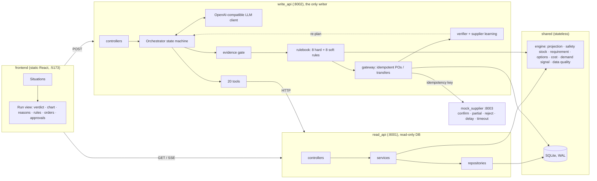
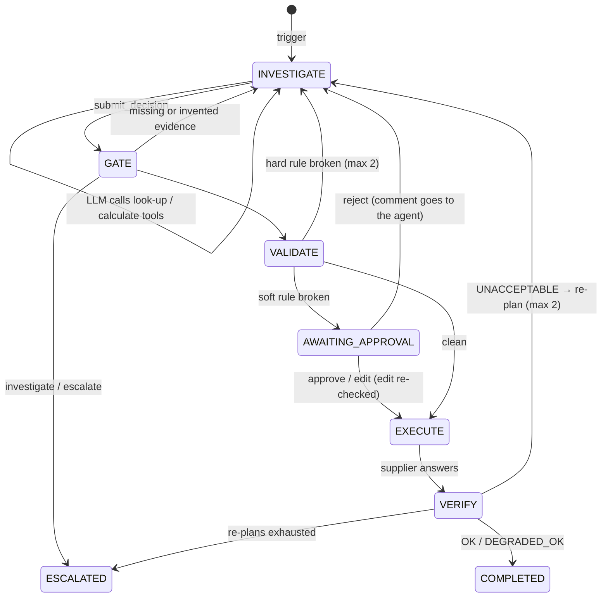

# AI Purchasing Agent

An agent for a quick-commerce business (dark stores) that takes a purchasing situation, **investigates**
the facts, **decides**, **acts** (places purchase orders or moves stock between stores), and **verifies
its own action** against what the supplier actually did. It is not a chatbot that answers purchasing
questions.

| Scenario | Trigger | What the agent works out |
|---|---|---|
| **S1** Review a recommendation | the replenishment system proposes a PO | accept / modify / reject / investigate: open POs it ignored, MOQ vs shelf life, phantom stock |
| **S2** Supplier can't fulfil | a supplier confirms only part of a PO | does it matter? transfer from another dark store, second supplier, or escalate |
| **S3** Demand changed | sales diverge from the forecast | real level change vs promotion vs one-off spike; plan on evidenced demand |
| **S4** Constraints | any of the above | storage on delivery day, budget, shelf life, express bridge, human approval, re-plan after a partial delivery |

---

## Quick start
Requirements: Python 3.12+, Node 20+.
```bash
make setup     # venv + npm install; creates backend/.env and backend/llm.env from the examples
make dev       # read_api :8001 · write_api :8002 · mock_supplier :8003 · UI http://localhost:5173
make test      # 114 tests, no API key needed
make lint      # ruff (backend) + oxlint (frontend)
make smoke     # real processes, one scenario end to end
make eval      # scenario evaluation → backend/evals/reports/
```
In the UI, pick a situation and click **Run with LLM** or **Run with rules only** (no key needed).
After pulling schema changes, run `make clean` once.

---

## Use any AI by changing one env file

The LLM is reached through **one OpenAI-compatible client** configured by **three generic fields** in
`backend/llm.env`. No provider name appears anywhere in the code, so switching provider or model is an
edit to this file and a restart; there is nothing to change in code.

```env
LLM_BASE_URL=https://generativelanguage.googleapis.com/v1beta/openai/
LLM_API_KEY=...
LLM_MODEL=gemini-3.5-flash-lite
```

| To use | `LLM_BASE_URL` | `LLM_MODEL` (example) |
|---|---|---|
| Google Gemini (free tier) | `https://generativelanguage.googleapis.com/v1beta/openai/` | `gemini-3.5-flash-lite` |
| OpenRouter (many models, some free) | `https://openrouter.ai/api/v1` | `nvidia/nemotron-3-ultra-550b-a55b:free` |
| Anthropic Claude | `https://api.anthropic.com/v1/` | `claude-sonnet-5-5` |
| OpenAI | `https://api.openai.com/v1` | any tool-calling model |
| Groq | `https://api.groq.com/openai/v1` | any tool-calling model |
| Local Ollama | `http://localhost:11434/v1` (key: `ollama`) | any local model with tool support |

How to switch:
1. Edit the three lines, or copy a preset from `backend/llm-examples/` (Gemini and OpenRouter, both tested).
2. `make llm-check ENV=llm.env` sends a tiny tool-call test and reports whether the endpoint works and
   the model really calls tools.
3. `make llm-models ENV=llm.env` lists the model ids the endpoint offers.
4. Restart `make dev`.

To compare models without touching code, keep several env files and pass them all to the evaluation:
`make eval LLM_ENVS="llm-examples/gemini-lite.env llm-examples/openrouter-nemotron-ultra.env"`.

Optional fields:
- `LLM_MODE`:
  - `live` (default) calls the endpoint above;
  - `baseline` runs the same agent with a deterministic, rule-based brain and no LLM at all.
- `LLM_MIN_INTERVAL_S` and `LLM_RATE_LIMIT_WAITS` pace calls and wait out per-minute limits (free tiers).
- `LLM_TEMPERATURE` (default 0), `LLM_MAX_TOKENS`, `LLM_TIMEOUT_S`, `LLM_MAX_RETRIES`.

What makes this work across providers (all in `write_api/llm/openai_compat.py`, with no provider-specific branches):
- **Our code checks the model's output.** Tool schemas are plain JSON Schema with references inlined,
  and tool arguments and the decision form are validated by our code, so a provider that ignores
  `strict` schemas can't slip bad data through.
- **Provider extras are passed back.** Some providers attach extra fields to a tool call (Gemini's
  reasoning signature, for example); these are echoed back unchanged on the next turn.
- **Tool calls written as text are recovered.** Some small models write a tool call as JSON in the text
  instead of as a real tool call; it is recovered and then validated like any other call.
- **Provider errors are reported as such.** Rate limits and auth problems are reported as provider
  errors, not as the agent's mistakes, and a daily quota stops the run instead of retrying.

---

## What I built

| Part | What it does |
|---|---|
| **Planning engine** (`shared/engine`) | Pure maths: day-by-day stock projection, safety stock, real need, candidate plans with costs and rule checks, demand signal, data-quality flags |
| **Read API** (`read_api`, :8001) | Every query the agent and the UI make. Database opened read-only |
| **Write API** (`write_api`, :8002) | The only writer. Hosts the agent: orchestrator, 20 tools, prompts, evidence gate, rulebook (8 hard + 8 soft rules), order gateway, verifier, supplier learning |
| **Mock supplier** (`mock_supplier`, :8003) | Stands in for suppliers' APIs. Can confirm, confirm partly, reject, delay, change price or time out, per scenario |
| **UI** (`frontend`, :5173) | Pick a situation, watch the run live, see the verdict, stock chart, reasons, rule check, orders and supplier answers, approve or reject plans |
| **Scenarios + evaluation** (`fixtures`, `evals`) | 18 situations with hand-computed answers; code graders; a runner comparing any LLM with the rules-only brain |

---

## Architecture



### Run lifecycle


```
backend/
  shared/        stateless: config, DB schema, domain types, engine (pure maths), snapshot, logging
  read_api/      server/ controllers/ services/ repositories/ schemas/      queries only
  write_api/     server/ controllers/ services/ repositories/ schemas/      commands only
                 agent/ (orchestrator, prompts/*.md, tools, evidence gate, baseline brain)
                 llm/ · validation/rules/{hard,soft}/ · actions/ · verification/ · clients/
  mock_supplier/ simulated external supplier
  fixtures/      18 scenario worlds with hand-computed expected outcomes
  evals/         harness, graders, runner
  tests/         mirrors the code
frontend/src/    api/{read,write,stream}.ts mirror the backend split · pages/ · components/ · format.ts
```

---

## Why this structure

- **Two separate projects (backend and a static frontend).**
  - The UI is plain static files that talk to the APIs over HTTP, so either side can be replaced or
    hosted on its own.
  - `frontend/src/api/read.ts` and `write.ts` mirror the two backend services, so every UI call maps to
    one controller.
- **The read/write split (CQRS) is the agent's safety model, not just tidiness.**
  - Investigating and acting are physically separated. `read_api` opens SQLite with `mode=ro`, so any
    write fails at the database (a test proves it).
  - The agent gathers every fact through the Read API over HTTP, and can change the world only by
    submitting a decision to the Write API, which validates, asks for approval, executes and verifies.
  - "Could the agent have changed something while it was looking?" is answered by the architecture,
    not by trust.
- **The same layers in both services: `server/ → controllers/ → services/ → repositories/`.**
  - Controllers only parse and respond; services hold the use-cases; repositories are the only code
    that talks to the database.
  - Once you know one service, you know where everything is in the other.
- **The folder tells you the job, which makes debugging fast.**
  - A wrong number points to `shared/engine`; a surprising verdict points to one file in
    `write_api/validation/rules/hard|soft/` (one rule per file); a duplicate order points to
    `write_api/actions/gateway.py`.
  - Every log line and error carries `service`, `component` (the folder) and `run_id`, and each run's
    full trace and LLM calls are saved in `backend/var/runs/<run_id>/`.
- **`shared/` holds only stateless code** (types, maths, schema, config, logging).
  - The one shared database helper is the *snapshot* (database rows → engine input). The Write API must
    re-check a plan inside its own transaction right before writing; asking the Read API over HTTP
    would open a check-then-write race.
- **The boundaries are enforced, not just documented.**
  - `tests/architecture/test_imports.py` fails if `read_api` and `write_api` import each other, if
    `shared` imports either, or if the engine does any I/O.
- **The mock supplier is a separate service,** so the feedback loop runs against a real HTTP boundary
  with real failures (partial, rejected, timeout).
- **Prompts are `.md` files and scenarios are YAML.** Behaviour and test data can be read and edited
  without touching code.
- **No agent framework.** The whole loop is one plain, commented file (`write_api/agent/orchestrator.py`):
  every state transition and limit is visible and easy to change, and there is no framework magic to
  explain.

---

## Why code does the maths, not the LLM

Every number the agent relies on is computed by `shared/engine` (pure functions, no I/O). The LLM reads
results; it never calculates.

| Reason | What it means here |
|---|---|
| **Exact** | Safety stock, rounding to MOQ and case pack, day-by-day projections with expiry and storage are easy to get slightly wrong. Language models make arithmetic slips; code doesn't. |
| **Repeatable** | The same situation always gives the same numbers, so a decision can be audited and replayed. |
| **Testable** | The engine is unit-tested against hand-computed answers for all 18 scenarios. A probabilistic model can't be tested like that. |
| **Explainable** | Every result exposes its working (e.g. "need = demand over 10 days 1000 + safety stock 157 − on hand 300 − open POs 400 = 457 → MOQ 500"), which the agent quotes as evidence. |
| **Cheap and fast** | A projection costs microseconds instead of tokens. |
| **Shared with the safety checks** | The rulebook and the verifier use the same engine, so the agent, the rules and the after-the-fact check can never disagree about the numbers. |

Evidence that this matters: writing the scenarios by hand and in code independently caught mistakes in
both. The engine found that the 800-unit recommendation would also let 100 units expire, which I had
missed. And a hand-sized express bridge only kept stock above zero, not above safety stock.

The LLM does what code is bad at:
- deciding what to look at;
- noticing that data doesn't add up;
- telling a promotion from a real trend;
- reading a supplier's message;
- weighing trade-offs between feasible plans;
- explaining the decision;
- re-planning when reality differs.

---

## How the LLM is kept from guessing

Each guard sits in a specific place in the code, and each was checked against real model behaviour in
the live runs.

| Guard | How it works | Where |
|---|---|---|
| **Facts only from tools** | The prompt requires looking things up; every fact comes from a Read API tool. | `agent/prompts/system.md`, `agent/tools/read/` |
| **Numbers only from the engine** | Requirement, projection, options and a rule-check dry run are tools; the prompt forbids mental arithmetic. | `agent/tools/compute/` |
| **Options are generated, not invented** | The engine lists feasible plans with costs and rule checks; the model chooses and must give a concrete reason to depart from the top one. | `shared/engine/options.py` |
| **Evidence must be real** | Every reason cites `evidence_id`s; the gate rejects ids that weren't real, successful tool results of this run (models *did* invent ids before this). | `agent/evidence_gate.py` |
| **Required checks per decision** | The gate refuses, say, a purchase without looking at open POs, storage, budget and supplier terms; or a demand decision without the raw sales and promotions. | `agent/evidence_gate.py` |
| **Structured output, validated** | Tool arguments and the decision form are Pydantic-validated; errors go back to the model with what to fix. | `agent/tools/registry.py` |
| **Forecast overrides must be stated** | If the model plans on a demand other than the forecast, it must state it; validation and verification use the same figure; more than the sales evidence supports needs a human. | `validation/rules/soft/forecast_override.py` |
| **No write tool** | The model can only submit a decision; it can't place an order. | `agent/tools/terminal/` |
| **Rules re-check everything** | Hard rules block, soft rules need a human, recomputed against the database right before any write. | `validation/` |
| **Reality is checked** | After acting, the supplier's real answer is re-projected; a gap sends the agent back to re-plan or escalate. | `verification/` |
| **Bounded behaviour** | Limits on tool calls per round, format retries, revisions and re-plans; then escalate, never loop. | `policy.yaml`, `agent/orchestrator.py` |
| **Low randomness** | Temperature 0 by default. | `llm.env` |
| **Compared with a no-LLM brain** | The same pipeline runs with deterministic rules, so you can see where the LLM helps and where it adds risk. | `agent/baseline_policy.py`, `evals/` |

---

## How decisions are validated (the feedback loops)
1. **Before acting.**
   - The *evidence gate* checks what was looked at and what was cited.
   - The *rulebook* re-evaluates the plan against the current database inside the write transaction. A
     hard failure goes back to the agent with the reasons; a soft one goes to a human, who can approve,
     reject (their comment goes to the agent) or edit (re-checked against hard rules).
2. **After acting.**
   - The gateway places POs and transfers with idempotency keys (a timeout is retried with the same key,
     so there is never a duplicate).
   - The supplier's real answer is stored and stock is re-projected. The verifier compares actual vs
     planned: **OK**, **DEGRADED_OK**, or **UNACCEPTABLE** with the remaining need. UNACCEPTABLE goes
     back to the agent to re-plan (bounded), then escalates.
3. **Learning.** Every supplier answer updates its fill rate and on-time rate. A shortfall marks the
   supplier unavailable.

### Rules at a glance
- **Hard rules (never overridden, not even by a buyer's edit):** storage on every day, shelf life,
  MOQ/case pack, supplier availability, delivery calendar, no duplicate orders, transfer only from surplus.
- **Soft rules (allowed only with a buyer's approval):** budget, avoidable stockout, below safety stock,
  order value, buying >30% *more* than recommended, express premium, supplier reliability, demand above
  the evidence.
- **How the need is computed:**
  - The protection interval is the arrival offset (lead time, order cut-off, delivery weekdays) plus
    the review period.
  - Safety stock `z·√(Σσ²_d + d̄²σ²_L)` sits on the *need* side.
  - Stock is projected day by day with first-expiring-first lots; unmet demand is a lost sale, not a
    backorder.

---

## Real purchasing problems and how the agent counters them

These are the buyer's problems, not technical ones. Each has a scenario in `backend/fixtures/` that
proves the counter-measure works.

### When the numbers lie
| Problem | Why it hurts | How we counter it | Proven by |
|---|---|---|---|
| **The recommendation is wrong** (e.g. it forgot an order already on its way) | Buying twice: cash tied up, shelves overflow, stock expires | The real need is recomputed from scratch: demand + safety stock − stock on hand − orders arriving *in time* (each on its real date). The agent never trusts the recommended quantity | `s1_modify_open_po_ignored` (800 → 500) |
| **The stock record is wrong** ("phantom stock": the system says 0 but the product keeps selling) | Ordering on top of bad data overflows the store, or misses a real stockout | Data-quality checks flag sales with zero stock and stale counts. The agent stops and asks for a stock count instead of buying | `s1_investigate_phantom_stock` |
| **Sales hide real demand** (days the shelf was empty show low sales) | The forecast learns too low and the next order is too small | Stockout days are flagged and left out of averages. *Acting* on it (cutting an existing order) is listed as a limitation | data-quality check `censored_demand` |
| **Safety stock counted twice** | Treating the buffer as available stock quietly removes the buffer | Safety stock sits on the *need* side of the formula, never on the supply side | engine tests |

### When the order can't be delivered as planned
| Problem | Why it hurts | How we counter it | Proven by |
|---|---|---|---|
| **No room on delivery day** (the total is right, but it all arrives at once) | The chilled room overflows and stock is lost | Stock is projected day by day, and storage is checked on *every* day for its temperature zone. The order is split into two deliveries | `s4_storage_two_drops` |
| **Cheap supplier's minimum order would expire** | Paying less per unit but throwing a third away | Expiry is projected lot by lot (first-expiring sells first). The agent switches to a supplier with a smaller minimum, or escalates if there isn't one | `s1_modify_moq_vs_shelf_life`, `s4_moq_exceeds_shelf_life` |
| **Standard delivery arrives after we run out** | Lost sales, and in quick-commerce the customer may not come back | A small express "bridge" covers only the gap (keeping safety stock), and the rest goes standard. Paying for express on everything needs approval | `s4_leadtime_express_bridge` |
| **Delivery days and cut-off times** ("3-day lead time" isn't 3 days if the supplier only delivers Tue/Fri) | Plans assume stock that won't be there | The arrival date is computed from the supplier's cut-off hour and delivery weekdays, not "today + lead time" | engine tests |

### When suppliers don't do what they said
| Problem | Why it hurts | How we counter it | Proven by |
|---|---|---|---|
| **The supplier confirms only part of the order** | The plan silently stops covering demand | After every order, the supplier's *real* answer is re-projected. If it's short, the agent re-plans for the remaining gap (or escalates) | `s4_feedback_partial_confirm` |
| **Re-ordering from the supplier that just failed** | The same failure twice | A shortfall or rejection records that supplier as unavailable, and a hard rule blocks ordering from it | `s2_alt_supplier` |
| **Fixing one store by emptying another** | The stockout just moves to the next store | A transfer can only take a store's *surplus*, beyond its own need. The agent compares a transfer with a second supplier | `s2_transfer_from_node` |
| **Panic when the shortfall doesn't matter** | Needless extra orders and cost | The agent first checks whether stock plus the confirmed part still covers the cycle. If yes, it does nothing | `s2_partial_but_sufficient` |
| **Every option fails** (the second supplier refuses too) | An agent retrying forever, or giving up silently | Re-plans are capped. With nothing feasible, it escalates to a buyer with the facts | `s2_alt_supplier_rejects_escalate` |
| **The supplier's system times out after taking the order** | A naive retry creates a duplicate order | Every order carries an idempotency key, so a retry returns the original order and never a second one | `s4_timeout_retry_idempotent` |
| **Suppliers that keep under-delivering** | Plans keep trusting a bad supplier | Each answer updates the supplier's fill rate and on-time rate. Ordering from a low-reliability supplier needs approval | supplier learning |

### When demand changes
| Problem | Why it hurts | How we counter it | Proven by |
|---|---|---|---|
| **A real, lasting jump in sales** | The existing plan runs out early | `analyze_demand` sees most days elevated with no promotion, and the agent plans on the new level | `s3_sustained_spike` |
| **A promotion spike mistaken for a trend** | Overbuying ~500 units after the promotion ends | Elevated days inside a promotion count only until it ends; the plan is kept | `s3_promo_spike_temporary` |
| **A one-day spike** (e.g. a bulk order) | Overreacting to noise | One elevated day is classified as a one-off, and the forecast stands | `s3_one_day_noise` |
| **Inflating demand to justify buying more** | An agent that talks itself into big orders | Any demand assumption must be stated in the decision. Assuming more than recent sales support needs a buyer's approval | rule `forecast_override` |

### When money and people are involved
| Problem | Why it hurts | How we counter it | Proven by |
|---|---|---|---|
| **The budget is too small for the full need** | Either overspend or knowingly risk running out | Both breaks are *soft* rules: the agent proposes the plan and a buyer decides, with an editable quantity | `s4_budget_partial_needs_approval` |
| **Knowingly accepting lost sales** | "Buy nothing" looks safe but empties the shelf | Doing nothing is checked like any plan; projected avoidable lost sales need a human | `s4_moq_exceeds_shelf_life` |
| **Buying far more than the system suggested** | Silent overspending | More than 30% above the recommendation needs approval. Buying *less* doesn't, when the projection proves coverage | rule `increase_over_recommendation` |
| **Asking humans too often** (alert fatigue) | Buyers stop reading the alerts | Approval is needed only when a soft rule is actually broken. Clean plans execute on their own, so the "rules only" run needs approval in just 1 of 18 scenarios | evaluation |
| **Accountability for overrides** | Nobody knows who decided what | Every approval, rejection and edit is recorded with who and why. A buyer's edit is re-checked against the hard rules (a human can't break those either) | `test_human_edit_is_still_checked_by_hard_rules` |

---

## Evaluation

**Ground truth comes from outside the agent.** Each of the 18 fixtures in `backend/fixtures/` holds:
- a complete world: stock, forecasts, sales, open POs, suppliers, budgets, storage, promotions, other stores;
- a trigger and injected supplier behaviour;
- an **expected outcome computed by hand**, with the arithmetic in its `notes`.

**Graders are code** (`backend/evals/graders.py`), mapped to the assignment's questions:

| Question | Checks |
|---|---|
| Correct decision? | decision type, quantity range, lines, supplier, transfers, demand assumption |
| Obtained the necessary information? | required tools called; evidence cited correctly first time |
| Respected constraints? | rulebook passed before every action; human approval exactly when expected |
| Appropriate action? | PO count; no duplicate orders on our side or the supplier's |
| Validated the result? | verified after every action; final verification as expected |
| What if the first action fails? | recovered by re-planning (+ quantity), or escalated; run finished cleanly |

A run passes only if **every** check passes.
- LLM runs are repeated and reported as pass rates.
- Provider failures (rate limits, auth) are reported separately and never counted against the agent.
- Scripted-LLM tests force misbehaviour on purpose: invalid JSON, invented evidence, a rule-breaking
  plan, a model that stops calling tools, budget exhaustion, and human approve / edit / reject.

### Results
Live runs on free tiers, 2026-11-02, one repeat per scenario. That is a small sample, so read these as
indicative, not as precise rates.

| Brain | Scenarios passing every check |
|---|---|
| Rules only (deterministic, no LLM) | **18 / 18** |
| `gemini-3.5-flash-lite` (Google AI Studio, free): full run | **14 / 18** (78%) |
| `gemini-3.5-flash-lite` after the fixes below (the 4 failures re-run) | **17 / 18** (94%) |
| `nvidia/nemotron-3-ultra-550b-a55b:free` (OpenRouter) | 4 / 4 S1 scenarios, then the free daily quota (~50 requests) ran out |

**What the live runs taught us (all fixed in the design unless noted)**
- **Invented evidence ids.** Models can't see provider-assigned call ids, so the first model invented
  them; every tool result now carries its own `evidence_id`.
- **Gemini HTTP 400 on the next turn.** Gemini rejected every follow-up turn because a reasoning
  signature wasn't sent back; provider extras are now echoed back unchanged.
- **A correct re-plan was cut off** by a run-wide tool budget; the budget is now per planning round,
  with a warning near the end.
- **Wrong label, right outcome.** A shortfall that didn't matter was labelled `reject` instead of
  `accept`; `reject` is now refused outside recommendation reviews.
- **Skipped raw evidence.** The model leaned on the demand summary and skipped raw sales; the prompts now
  list the required checks.
- **Still open:** when the only supplier's minimum order would mostly expire, Flash-Lite chose `reject`
  rather than escalating. The rulebook saw the projected 260 lost sales and **forced human approval**,
  so the safety net held. This is a model judgment limit, and it isn't papered over by more prompt
  tuning.

---

## Limitations / next steps
- **Censored demand isn't acted on.** When sales drop because shelves were empty, acting would mean
  reducing or cancelling an open PO, and there is no such action yet.
- **Shared constraints are simplified.** Storage and budget are shared across SKUs only through a fixed
  "other SKUs" occupancy; there is no joint multi-SKU optimisation.
- **Small live sample.** Free-tier quotas limited the live evaluation to one repeat per scenario.

Every push is tagged `checkpoint-NN-<name>` (`git tag`), so any stage can be checked out and run.
