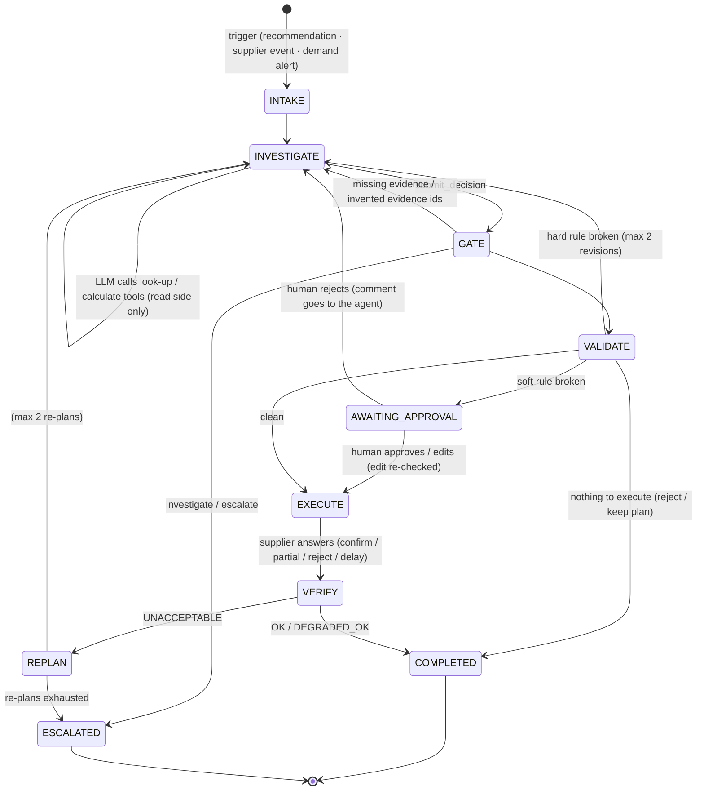

# Architecture

## In one picture

```mermaid
flowchart LR
    subgraph UI["frontend (static React, :5173)"]
        L[Scenario launcher] --> RV[Run view: trace · decision · rulebook · chart · approvals]
    end

    subgraph R["read_api (:8001) — read-only DB"]
        RC[controllers] --> RS[services] --> RR[repositories]
        RS --> ENG
    end

    subgraph W["write_api (:8002) — the only writer"]
        WC[controllers: runs · approvals · fixtures · supplier-events · demand-alerts]
        ORCH[Orchestrator<br/>state machine + limits]
        LLM[llm/ OpenAI-compatible client<br/>LLM_BASE_URL · LLM_API_KEY · LLM_MODEL]
        TOOLS[19 tools<br/>look-up · calculate · finish]
        GATE[evidence gate]
        VAL[validation: 8 hard + 8 soft rules]
        ACT[actions/gateway<br/>idempotency · approvals]
        VER[verification + supplier learning]
        WR[repositories]
        WC --> ORCH
        ORCH <--> LLM
        ORCH --> TOOLS
        ORCH --> GATE --> VAL --> ACT --> VER
        ACT --> WR
        VER -. re-plan .-> ORCH
    end

    subgraph S["shared (stateless)"]
        ENG[engine: projection · safety stock · requirement · options · cost · demand signal · data quality]
        DB[(SQLite, WAL)]
        SNAP[snapshot: DB → engine input]
    end

    SUP[mock_supplier (:8003)<br/>confirm · partial · reject · delay · timeout]

    UI -- GET / SSE --> R
    UI -- POST --> W
    TOOLS -- HTTP GET --> R
    VAL --> SNAP
    RR --> DB
    WR --> DB
    SNAP --> DB
    ACT -- HTTP + idempotency key --> SUP
```

## The run lifecycle (state machine)



## Who does what

| Part | Responsibility | Why it is here |
|---|---|---|
| `shared/engine` | All maths: day-by-day FEFO projection (expiry, storage per day, lost sales), safety stock, time-phased requirement, candidate options with decision cost and per-rule checks, demand signal, data-quality flags | Deterministic and fully tested; LLMs make arithmetic mistakes |
| `read_api` | Every query the agent and UI make. DB opened with `mode=ro` | Investigation physically cannot change anything |
| LLM (via `write_api/llm`) | Plans the investigation, interprets evidence (bad data, promotions, supplier messages), chooses among engine options, writes the decision + explanation, re-plans | Judgment; no tool lets it write directly |
| `write_api/agent` | Orchestrator state machine, tool registry (Pydantic-validated args), prompts (.md), evidence gate, no-LLM baseline brain | Code controls the flow and the limits; the model controls choices |
| `write_api/validation` | One file per rule; hard rules block, soft rules require a human | Rules applied identically every time, re-evaluated inside the write transaction |
| `write_api/actions` | The only code that creates POs / transfers: idempotency keys, retries with the same key, budget commitment | No duplicate orders, ever (tested with an injected timeout) |
| `write_api/verification` | Re-projects with the supplier's *real* answer; OK / DEGRADED_OK / UNACCEPTABLE + remaining need; updates supplier statistics | The feedback loop |
| `mock_supplier` | A separate service standing in for suppliers' APIs, with per-scenario misbehaviour | Lets the feedback loop be exercised for real |

## The three feedback loops
1. **Before acting (validation):** the evidence gate checks that the agent looked at what it must and cited real tool results. Then the rulebook re-evaluates the plan against the current DB. A hard failure goes back to the agent with the reasons; a soft failure goes to a human.
2. **After acting (verification):** the supplier's real answer (partial, rejected, late, re-priced) is written to the DB, stock is re-projected, and the outcome is compared with the plan. UNACCEPTABLE outcomes go back to the agent with the remaining gap (bounded), then escalate.
3. **Learning:** every supplier answer updates that supplier's fill rate and on-time rate, and a shortfall records the supplier as unavailable, so the next decision (and the reliability rule) sees real behaviour.

## Reliability measures
- Tool arguments and the decision form are validated by our code, whatever the provider; errors go back to the model with what to fix.
- Tool calls a model writes as plain text are recovered and validated like any other.
- Limits on tool calls, format retries, revisions and re-plans → escalation instead of loops.
- Idempotent execution; crash recovery reuses the same POs.
- Every step of every run is in the DB (`trace_steps`, streamed to the UI) and in `backend/var/runs/<run_id>/{trace,llm_calls}.jsonl`.
- `tests/architecture/test_imports.py` enforces the read/write boundaries; a test proves the read side can't write.

See [decisions.md](decisions.md) for the reasoning behind each choice and [structure.md](structure.md) for the folder map.
